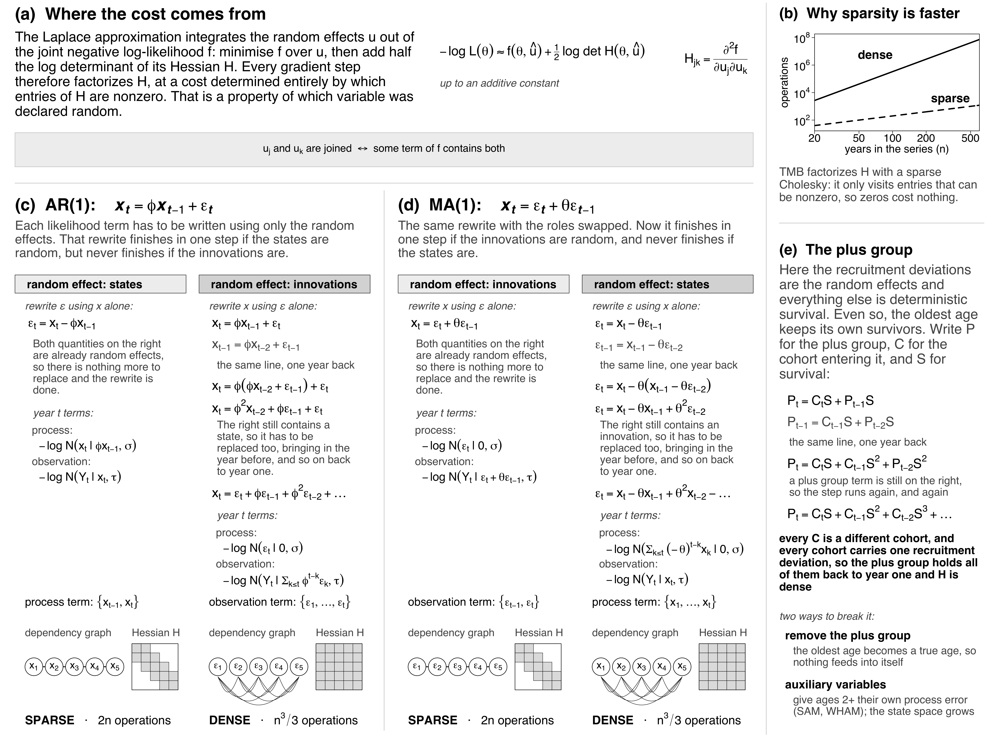

```{r setup, include=FALSE}
knitr::opts_chunk$set(
  echo = FALSE, warning = FALSE, message = FALSE,
  fig.width = 7, fig.height = 5
)
library(ggplot2)
library(gridExtra)
library(dplyr)
library(tidyr)
library(knitr)
library(here)

# generate bib file
source(here("FisheriesResearch_manuscript/BuildBibFile.R"))
build_bib_file()
```

\
$^{a}$NOAA Fisheries, Office of Science and Technology, Silver Spring, MD, USA  
$^{b}$Danish Technical University, Aqua, Kongens Lyngby, Denmark  
$^{c}$Vaughan Analytics, in support of NOAA Fisheries Southeast Fisheries Science Center, Miami, FL, USA  
$^{d}$NOAA Fisheries, Northwest Fisheries Science Center, Seattle, WA, USA  
\
\
$^{*}$**Corresponding author at:**  
NOAA Fisheries, Office of Science and Technology, 1315 East-West Highway, 12th Floor, Silver Spring, MD, 20190, USA  
Email address: andrea.havron@noaa.gov  
\
\
ORCID ID:  
Andrea Havron: 0000-0002-4080-448X  
Anders Nielsen: 0000-0001-9683-9262  
Nathan Vaughan: 0009-0000-3054-6950  
Eric Ward: 0000-0002-4359-0296  

\newpage

# Abstract{-}

  **[250 word limit]:**   
  Many stock assessment models in the U.S. have been developed in ADMB using a hierarchical approach for time-varying processes, where mean parameter values $\bar{\theta}$ and fixed effect annual deviation values $dev_{y}$ are estimated and combined to produce annual parameter estimates $\hat{\theta}_{y} = \bar{\theta} * dev_{y}$. This structure was intuitive and enabled parameter means to be estimated in earlier phases than deviations, which improved convergence. Following statistical best practices, several next generation stock assessment models have incorporated the use of random effects through TMB to model process variability in time-varying parameters. This approach does not require parameter phasing but does require the calculation of up to third-order partial derivatives and Hessian inversion at each optimization step to integrate out random effect uncertainty using the Laplace approximation. While simple to interpret and implement, the deviations approach results in a dense covariance matrix of correlations 
  between the mean $\bar{\theta}$ and each annual deviation $dev_{y}$ estimate. Due to this difference, the deviations approach in a random effects model has a much larger computational penalty than in historic fixed effects modeling platforms.  We test an alternate configuration of directly estimating annual recruitment values as random effects in AR1 and MA1 processes. While the former structure has a sparse covariance matrix and reduces model estimation time, the latter produces the opposite result. Optimization time and parameter estimates from stock assessment models under these equivalent sparse versus dense parameterizations are compared to confirm equivalency and performance improvement of the new structure. These results inform development in next generation stock assessment models.

# Keywords{-} 
You are required to provide 1 to 7 keywords for indexing purposes. Keywords should be written in English. Please try to avoid keywords consisting of multiple words (using "and" or "of").

We recommend that you only use abbreviations in keywords if they are firmly established in the field.

# Highlights{-}
You are required to provide article highlights at submission.

Highlights are a short collection of bullet points that should capture the novel results of your research as well as any new methods used during your study. Highlights will help increase the discoverability of your article via search engines. Some guidelines:

- Submit highlights as a separate editable file in the online submission system with the word "highlights" included in the file name.

- Highlights should consist of 3 to 5 bullet points, each a maximum of 85 characters, including spaces.

\newpage
# Notes for Manuscript Development
Key points:

-   Lots of variable implementations of random effects for recruitment - deviations vs recruitment, often chosen for convenience

-   Unclear whether ML results will translate to Bayesian estimation

    -   lots of history in comparing centered vs non-centered REs

    -   best practices in creating sparsity pretty well understood in TMB, less clear what this means for MCMC

Gap / objective - tools such as tmbstan now allow TMB/RTMB models to be
passed directly to Stan

-   meaningful comparisons require verifying that the RTMB and Stan implementations encode the same posterior

-   we systematically compare sampling efficiency, convergence, and effective sample size across five combinations of MA(1) and AR(1) recruitment models, using both RTMB-tmbstan and Stan
    1. Is treating recruitment deviations or recruitment more efficient?
    2. What is the impact of RTMB's dautoreg function?

-   other?

* need to decide on jargon: innovations vs deviations? process v. log-recruitment? etc

# Introduction

Hierarchical model efficiency is not merely a matter of software implementation but is fundamentally tied to the the geometric and structural properties of the statistical model. State-space time series models, which fit a latent state to account for unobserved variability in the data, are structured under Markov properties of conditional indepence dictating that the past and present are independent conditional on the present, and that observations are conditionally independent given the latent state [@Aeberhard_2018, @Auger_M_th__2021, @Shumway_2025]. The Markov property of the latent state, however, is sensitive to its parameterization which can result in different structures and geometries that have a direct result on model efficiency.    

Centered and non-centered parameterizations are frequently used in statistical modeling to improve model efficiency. Under a centered parameterization, the latent state $x|\theta, \sigma_x$ is centered on a distribution, $x \sim N(f(\theta), \sigma_{x})$, which results in a latent state Markov structure in autoregressive models and dependent states in moving average models (Figure \@ref(fig:figure-1)c-d). In contrast, the non-centered parameterization introduces an auxilliary variable, $\epsilon$, to capture the latent variability, so that $x = f(\theta) * \epsilon; \epsilon(0, \sigma_{x})$, which results dependent states in autoregressive models and a latent state Markov structure in moving average models (Figure \@ref(fig:figure-1)c-d). 

```{r figure-1, echo=FALSE, fig.cap="Sparsity Structure. a). Cost of Sparsity. b) Sparsity and speed. c) AR1 and Sparsity. d) MA1 and Sparsity. e) Sparsity and the Plus Group", out.width="100%"}

```

How these parameterizations affect computational efficiency can depend on the method of inference. In Bayesian analysis, the *apriori* correlation between the latent state and the fixed effects parameters have an impact on the geometry of the posterior. In MCMC sampling, particularly within the Hamiltonian Monte Carlo (HMC) framework utilized by Stan, the choice between centered and non-centered parameterizations is often a response to the funnel geometry pathology (@Betancourt_2019). This pathology occurs when a sampler struggles to explore the narrow regions of a distribution where the group-level variance is small -- a common issue in hierarchical models with sparse data (?Monnahan et al., 2016). Specifically, a non-centered parameterization effectively stretches this funnel, allowing HMC to sample more efficiently by breaking the strong a priori dependence between hierarchical levels (@Gorinova_2020). However, if the data are highly informative, a centered parameterization may actually be more efficient, as the data can "pin down" the parameters and reduce the correlations that otherwise slow down the sampler (@Papaspiliopoulos_2007, @Gorinova_2020). 

[WIP] Under Maximum Likelihood Estimation, the affect of *apriori* dependence between the latent state and fixed parameters is insignificant. Of greater consequence is the structure of the joint Hessian, which is inverted and used in calculations to evaluate the Laplace Approximation and determing parameter confidence intervals. 


Within the context of fisheries stock assessment models, there are many examples of hierarchical variables being estimated with centered or non-centered pararmeterizations; one of the clearest example of this is when variability is added to recruitment via the centered parameterization, $recruitment \sim N(\mu_{r}, \sigma_{r})$, or by modeling the deviations around a mean, $deviations \sim N(0, \sigma_{r}), recruitment = \mu_{r}*deviations$ (non-centered parameterization). Historically, models reliant on ADMB estimate the deviations as fixed effects undered a constrained optimization where the variance, $\sigma_{r}$ is fixed. In several tools, such as Stock Synthesis (@Methot_2013), sum to zero constraints have been applied to ensure that Hessian matrices are positive definite. A fixed-effect vector of deviation parameters does not require second order partial derivatives to be estimated until model optimization is complete and variance is estimated. 

Several next generation stock assessment models have changed dependency from ADMB to Template Model Builder (@Kristensen_2016) in order to incorporate the use of the Laplace approximation to integrate out hierarchical variables (i.e. random effects), allowing the estimation of the hierarchical variance parameter, e.g. $\sigma_{r}$ (@Berg_2016, @Miller_2020; FIMS, CITE). The Laplace approximation requires up to third-order derivates for its evaluations, thus necessitating a Jacobian calculation and Hessian inversion at each optimization step. By contrast to SS3's deviations approach, these state-space platforms treat log-recruitment itself as the latent state, and estimate $\sigma_{r}$ directly within the Laplace approximation. As assessment scientists migrate legacy ADMB models to these state-space frameworks, or build new models, the choice between the two parameterizations is no longer a matter of computational convenience but a design decision with direct consequences for run time and sampling efficiency.

The move toward Bayesian fitting of these same stock assessment models using adnuts and tmbstan (@Monnahan_2018) has made this parameterization question important for a second reason. Outstanding technical issues in Bayesian data-rich stock assessment include challenges to parameterizing assessments to be amenable to the estimation of process errors, a step not consistently taken in current operational Bayesian assessments using NUTS (@Monnahan_2019). Comparative parameterizations have been conducted for Bayesian state-space surplus production models; these include comparing sampling diagnostics, sampling efficiency, and posterior inferences among multiple parameterizations of a state-space biomass dynamics model (@Best_2020) and for hierarchical population models more generally (@Monnahan_2016), but to our knowledge no equivalent comparison exists for age-structured recruitment processes under alternative random effect error structures.

To quantify the magnitude of this penalty we investigate the performance and optimization time under a hierarchical autoregressive and moving average model under equivalent sparse vs dense parameterizations. For this example we utilize two simple proxy models; a time-series model and a stock assessment model based on babySAM (CITE). The latter proxy should reflect the relative performance gains expected in the real-world correlated time-varying processes modeled in stock assessments such as recruitment. Each of these time-series models can be written with both centered and non-centered parameterizations, allowng for benchmark comparisons, which are anticipated to produce mathematically equivalent results while differing in their computational overhead. Confirming this equivalency and quantifying the runtime improvement will provide support for the change in approach relative to previous assessment models.


# Methods

## Software tools

We conducted analyses in both maximum likelihood and Bayesian frameworks using TMB (Template Model Builder), RTMB, tmbstan, and Stan. TMB is an R package that enables efficient estimation of complex statistical models through automatic differentiation and Laplace approximation implemented in C++. RTMB provides a higher-level interface to TMB that allows model specification directly within R. For Bayesian estimation, Stan is a probabilistic programming language and statistical inference platform that uses gradient-based Markov chain Monte Carlo methods, including Hamiltonian Monte Carlo and the No-U-Turn Sampler. The tmbstan package integrates TMB and Stan by applying Stan's sampling algorithms to models specified in TMB, thereby facilitating Bayesian inference for models developed within the TMB framework. Together, these software tools support both maximum-likelihood and Bayesian approaches to fitting complex hierarchical and latent-variable models. [maybe add links to FIMS paper / decisions about why to use these methods / etc]. 

## Time series models and parameterizations

We considered both autogregressive AR(1) and moving average MA(1) structures because they represent distinct hypotheses about the memory of the underlying time series process, and because they can differ in the sparsity of the resulting Hessian matrix. Following standard time-series literature (CITE Shumway and Stoffer book), an MA(1) process has finite memory in that a shock propagates for exactly one time step, whereas an AR(1) process has potentially infinite memory, with each shock's influence persisting. In the context of modeling recruitment variability in fisheries, the AR(1) structure may be more appropriate when approximating a driver that persists across multiple years (ocean regimes, density dependence), while an MA(1) model may better suited for short term pulses (such as cohort effects).  We include both models here to test whether the sparsity results generalize across processes with fundamentally different memory structures.

 
Centered Parameterization

$x_{t} \sim N(\phi * x_{t-1}, \sigma_{x}^{2})$

Non-centered Parameterization

$x_{t} = \phi * x_{t-1} + z_{t}

z_{t} \sim N(0,\sigma_{x})$,

where $\sigma_{x}$ is the process standard deviation and $\phi$ is the autoregressive coefficient, transformed as: $\phi=2*(1/(1+exp(-\phi_{T})))-1$, which ensures $\phi$ remains in the range (-1,1). The stationary variance of the process is: $\text{Var}(x)=\frac{\sigma_{x}^2}{(1-\phi^2)}$. 

Under a random-effects model, the process parameterization puts the random effect on $x_{t}$, while in the deviations parameterization, the random effect is applied to $z_{t}$. The joint negative log likelihood for the AR1 and MA1 is computed in state-space form where the process of the current time step is dependent on the previous one and observations, $obs$ are *iid* Normal:

$obs_{t} /sim N(x_{t}, \sigma_{obs})$


The MA1 model is defined as: $x_t = \epsilon_{t} + \phi \epsilon_{t-1}$, using two parameterizations where the : 

1. process approach: <br>

$\epsilon_{0}$ = eps0$ <br>

$\epsilon_{t+1} = x_{t} - \phi \epsilon_{t}$

$epsilon_t \sim N(0, \sigma_{x})$

2. deviations approach: $x_{t} = w_{t} + \phi w_{t-1}$, with $w_t \sim N(0, \sigma_{w})$ 

where $\sigma_x$

**Process Parameterization**  

$w_{t} = x_{t} - \theta w_{t-1}$ <br>

$w_t \sim N(0, \sigma_{x})$ <br>

where $w$ and $x$ are treated as random

**Deviations Parameterization**  

$w_t \sim N(0, \sigma_{w})$ <br>

$x_{t} = w_{t} + \theta w_{t-1}$ <br>

where $w$ is treated as random.

The joint negative log likelihood for the AR1 and MA1 is computed in state-space form where the process of the current time step is dependent on the previous one and observations, $obs$ are *iid* Normal:

$obs_{t} /sim N(x_{t}, \sigma_{obs})$

### Stock Assessment Model Simulation

In addition to the simple time series model, we used an age-structured model based on the `simplefsa` fisheries
dataset [more detail from Anders]. The model tracks log-numbers-at-age
($\log N_{a,y}$) over age classes $a = 1, \ldots, A$ and years
$y = 1, \ldots, T$. Fishing mortality is modeled as a separable age-year
product $F_{a,y} = \exp(\log F_a + \log F_y)$. The population is
propagated forward by

$$\log N_{a,y} = \log N_{a-1,y-1} - F_{a-1,y-1} - M_{a-1,y-1}$$

where $M_{a,y}$ is natural mortality supplied as data. Observations
consist of commercial catch-at-age (fleet 1) and survey indices (fleet
2, ages 1–5), both modeled with lognormal observation error.

We implemented two formulations of recruitment dynamics, not in the same
model. First, we simulated annual recruitment deviations $\varepsilon_y$
as a first-order moving-average process (MA(1)),

$$\log N_{1,y} = \mu_R + \varepsilon_y + \theta \varepsilon_{y-1}, \quad \varepsilon_y \sim N(0, \sigma_R)$$

where $\theta = 2\,\text{logit}^{-1}(\tilde\theta_R) - 1$.

Our second formulation simulated annual recruitment as a first order
autoregressive AR(1) process,

$$\log N_{1,y} = \phi \log N_{1,y-1} + \mu_R(1 - \phi) + \sigma_R z_y, \quad z_y \sim N(0,1)$$
where the AR parameter $\phi = 2\,\text{logit}^{-1}(\tilde\phi_R) - 1$.

## Estimation

### Simple Time Series Analysis

We fit four model implementations under varying sample sizes (30 <= n <= 500), comparing both AR1 and MA1 non-centered versus centered parameterizations respectively (Table \@ref(tab:table1)). For each sample size, we ran benchmark analyses (n = 100 iterations) on the four models using the *bench* (@Hester_2025) package. Median run time and memory usage were compared for calls to MakeADFun (tape construction), nlminb (model optimization), and total run times.


```{r table1, echo=FALSE}
model_table <- data.frame(
  Model = c(
    "MA1",
    "MA1",
    "AR1",
    "AR1"
  ),
  `Random effect` = c(
    "$w, ~x$",
    "$w$",
    "$x$",
    "$z$"
  ),
  Parameterization = c("Centered", "Non-centered", "Centered", "Non-centered"),
  `Sample Sizes` = rep("{30, 50, 100, 200, 300, 400, 500}", 4),
  check.names = FALSE
)

knitr::kable(model_table,
  caption = "Summary of model implementations for the simple time series.",
  align   = c("l", "l", "c"),
  escape  = FALSE
)
```


### Simple Stock Assessment Analysis 

We compared five model implementations across the two recruitment
dynamics formulations (MA(1) and AR(1)), varying in the choice of random
effect and the resulting Hessian sparsity structure (Table \@ref(tab:table2)). For the
MA(1) models, we compared treating the innovations $\varepsilon_y$ or
recruitment $\log N_{1,y}$ directly as the random effect. When
innovations $\varepsilon_y$ are a random effect, $\log N_{1,y}$ is
computed deterministically MA(1) process, yielding a sparse banded
Hessian because each $\varepsilon_y$ connects only to its immediate
neighbors. In our second MA(1) estimation model with $\log N_{1,y}$ as
random effects, the $\varepsilon_y$ become derived quantities, with a
dense Hessian because each $\log N_{1,y}$ propagates through all future
time steps. [cite Kristensen 2016? Rue and Held?, other?]

For the AR(1) models, we implemented three estimation model variants.
RTMB includes a `dautoreg` function, which uses the banded precision
matrix of the AR(1) process for sparse Hessian evaluation. Our first
estimation approach treated the $\log N_{1,y}$ as random effects, and
utilized the `dautoreg` approach. To isolate the effect of this
function, our second approach involved an identical model, but we
replaced `dautoreg` with a loop, resulting in a dense Hessian from the
same statistical model. Parallel to our MA(1) comparison, we were also
interested in effects of treating the deviations as random effects; our
third estimation model treated the AR(1) deviations
$\varepsilon_y \sim N(0,\, \sigma_R\sqrt{1-\phi^2})$ as random effects,
with $\log N_{1,y}$ as derived quantities, also yielding a sparse
Hessian. Collectively these implementations allow us to disentangle the
effects of random effect choice and Hessian sparsity on sampling
efficiency.

We performed estimation using maximum likelihood and Bayesian approaches
(MCMC). Models were coded in RTMB (cite), and fitted model objects were
then passed directly to Stan via the `tmbstan` package (cite Monahan et
al.). For comparison purposes, we then re-coded estimation models
directly in Stan, and re-estimated parameters. Both MCMC approaches used
4 chains, with 4000 iterations each (retaining the last 2000). We
specified the target acceptance probability of the NUTS sampler to be
0.99 (`adapt_delta`). For Bayesian estimation (and RTMB equivalence),
all standard deviation parameters were given $N(0,1)$ priors on the log
scale, and all other parameters were given Stan's default flat priors.

```{r table2, echo=FALSE}
model_table <- data.frame(
  Model = c(
    "MA",
    "MA",
    "AR",
    "AR",
    "AR"
  ),
  `Random effect` = c(
    "$\\varepsilon$",
    "$\\log N_{1,y}$",
    "$\\log N_{1,y}$ (dautoreg)",
    "$\\log N_{1,y}$ (loop)",
    "$\\varepsilon$"
  ),
  Hessian = c("Sparse", "Dense", "Sparse", "Dense", "Sparse"),
  check.names = FALSE
)

knitr::kable(model_table,
  caption = "Summary of model implementations.",
  align   = c("l", "l", "c"),
  escape  = FALSE
)
```


For each combination of estimation model and implementation (RTMB, tmbstan, Stan) we summarized across the 100 replicates: mean sampling time
(seconds), mean and maximum $\hat{R}$, mean effective sample size (ESS),
and the number of parameters with $\hat{R} > 1.15$. Results are
presented as mean (SD) across replicates.

# Results

## Time Series Analysis

As sample size increases, computational efficiency followed expected patterns. With respect to AR1 model, both median run times and memory increased at a faster rate under the non-centered parameterization than the centered parameterization and there was an optimal sample size at which efficiency flipped due to the overhead of setting up the tape for the centered parameterization model (Figure). The opposite results were seen in the MA(1) model. Median run times and memory increased at a faster rate under the centered parameterization than the non-centered parameterization. This pattern held at small sample sizes indicating no overhead ...  (Figure). 

insert figure 1
insert figure 2

# Stock Assessment Analysis

For the AR(1) formulation, we found the strongest support for implementing random effects using the process (log-recruitment) as random effects, instead of the innovations (deviations). Across the 100 simulated datasets, the maximum likelihood optimization in RTMB was faster on average (Table \@ref(tab:table-ar-nodautoreg) vs Table (table-ar-deviations)). This difference becomes even stronger with our Bayesian comparisons. While we found similar effective sample size (ESS) and run time between `tmbstan` and `rstan`, parameterizing random effects in log-recruitment was more efficient: this approach resulted in 105.1 and 78.6 samples / second for `tmbstan` and `rstan` respectively, versus 6.4 and 17.5 samples / second for each when parameterizing random effects in innovations (Table \@ref(tab:table-ar-nodautoreg) vs Table (table-ar-deviations)). We found little difference in the AR(1) formulation on maximum likelihood estimation with and without RTMB's `dautoreg` function, (Table \@ref(tab:table-ar-dautoreg) vs Table \@ref(tab:table-ar-nodautoreg)).

For the MA(1) estimation model, we found that implementing random effects in the deviations resulted in faster maximum likelihood optimization (0.09 sec vs 0.15 sec, \@ref(tab:table-ma-good) \@ref(tab:table-ma-bad) ). Stan and tmbstan implementations had similar average speeds across the two implementations with slight efficiency advantages in `tmbstan` -- with random effects in deviations, `tmbstan` and `rstan` sampled 32.7 and 23.9 samples / sec, respectively, while with random effects in the process (log-recruitment), these approaches samples 30.57 and 25.2 samples / sec (0.09 sec vs 0.15 sec, \@ref(tab:table-ma-good) \@ref(tab:table-ma-bad) ).


```{r load-data}
## Load result files and standardize column names
load_results <- function(path, model_label) {
  d <- readRDS(path)

  if ("sampling" %in% names(d)) {
    names(d)[names(d) == "sampling"] <- "Type"
  }
  col_map <- c(
    sampling_time = "sampling_time",
    pars_hi_rhat  = "pars_hi_rhat",
    max_r_hat     = "max_r_hat",
    mean_n_eff    = "mean_n_eff",
    time_s        = "sampling_time",
    max_rhat      = "max_r_hat",
    mean_neff     = "mean_n_eff",
    min_neff      = "min_n_eff"
  )
  for (old in names(col_map)) {
    if (old %in% names(d)) names(d)[names(d) == old] <- col_map[old]
  }
  d$model <- model_label
  d
}

ma_good <- load_results(path = "../bayes/ma_good_results.rds", "MA(1) good")
ma_bad <- load_results(path = "../bayes/ma_bad_results.rds", "MA(1) bad")
# ar1 <- load_results("ar1_results.rds", "AR(1)")

ma_results <- bind_rows(ma_good, ma_bad)
ma_results$method[which(ma_results$method == "tmb")] <- "RTMB"
ma_results$Type <- factor(ma_results$method, levels = c("stan", "tmbstan", "RTMB"))

ar_good <- load_results(path = "../bayes/ar_good_results.rds", "AR(1) good")
ar_good_eps <- load_results(path = "../bayes/ar_good_eps_results.rds", "AR(1) eps")
ar_good_nodautoreg <- load_results(path = "../bayes/ar_good_nodautoreg_results.rds", "AR(1) no dautoreg")
```

```{r summary-fn}
## Summarise key metrics across replicates: mean (SD)
fmt_mean_sd <- function(x) {
  x <- x[is.finite(x)]
  sprintf("%.2f (%.2f)", mean(x), sd(x))
}

make_summary_table <- function(df) {
  metrics <- c(
    "sampling_time",
    # "max_r_hat",
    "mean_n_eff",
    "pars_hi_rhat"
  )
  labels <- c(
    "Sampling time (s)",
    # "Max Rhat",
    "Mean ESS",
    "N pars Rhat > 1.15"
  )

  types <- unique(as.character(df$method))
  out <- data.frame(Metric = labels)

  for (tp in types) {
    sub <- df[df$method == tp, ]
    col <- sapply(metrics, function(m) {
      if (m %in% names(sub)) fmt_mean_sd(sub[[m]]) else "—"
    })
    out[[tp]] <- col
  }

  out <- rbind(
    out,
    data.frame(
      "Metric" = "All Rhat < 1.15",
      tmb = NA,
      tmbstan = length(which(df$method == "tmbstan" & df$max_r_hat < 1.15)),
      stan = length(which(df$method == "stan" & df$max_r_hat < 1.15))
    )
  )

  out
}
```

```{r direct-comparison, echo=FALSE}
ma_good_rtmb <- dplyr::filter(ma_good, method == "tmb")
ma_bad_rtmb <- dplyr::filter(ma_bad, method == "tmb")
ma_good_stan <- dplyr::filter(ma_good, method == "stan")
ma_bad_stan <- dplyr::filter(ma_bad, method == "stan")
ma_good_tmbstan <- dplyr::filter(ma_good, method == "tmbstan")
ma_bad_tmbstan <- dplyr::filter(ma_bad, method == "tmbstan")
```


```{r table-ar-nodautoreg, results='asis'}
tab <- make_summary_table(ar_good_nodautoreg)
kable(tab,
  caption = "AR(1) implementation without dautoreg, and log-recruitment as random effects. Mean (SD) across 100 replicates.",
  align = c("l", "r", "r", "r")
)
```

```{r table-ar-deviations, results='asis'}
tab <- make_summary_table(ar_good_eps)
kable(tab,
  caption = "AR(1) implementation without dautoreg, and deviations as random effects. Mean (SD) across 100 replicates.",
  align = c("l", "r", "r", "r")
)
```

```{r table-ar-dautoreg, results='asis'}
tab <- make_summary_table(ar_good)
kable(tab,
  caption = "AR(1) implementation with dautoreg, and log-recruitment as random effects. Mean (SD) across 100 replicates. Because Stan doesn't have a dautoreg function, we compare against the Stan code without dautoreg.",
  align = c("l", "r", "r", "r")
)
```

```{r table-ma-good, results='asis'}
tab <- make_summary_table(ma_good)
kable(tab,
  caption = "MA(1) implementation, with deviations as random effects. Mean (SD) across 100 replicates.",
  align = c("l", "r", "r", "r")
)
```

```{r table-ma-bad, results='asis'}
tab <- make_summary_table(ma_bad)
kable(tab,
  caption = "MA(1) implementation, with log-recruitment as random effects. Mean (SD) across 100 replicates.",
  align = c("l", "r", "r", "r")
)
```

# Discussion

- Next gen software - need research to decide how to parameterize random effects (Andrea)

- Efficiency of sparsity with random effects

- For MA(1) models, we recommend modelling deviations as random effects (good parameterisation). The RTMB implementation was much faster, and treating recruitment as random effects led to really poor estimation for some Bayesian models (Stan)

- For AR(1) models, we recommend using recruitment as random effects. This was much faster than the deviations parameterization

- RTMB's 'dautoreg' function seemed to have little to no impact on MCMC sampling speed or efficiency


In contrast to general guidance from the Bayesian hierarchical modeling literature that suggests non-centered parameterizations of random effects are a better default, results from our simulations argue against a single rule of thumb for centering or not centering random effects in fisheries assessment models. The best implementation choice depends on the correlation structure of the underlying process: because recruitment deviations in an MA(1) process only ever propagate to the immediately following year, deviations remain sparse and near-independent, so the deviations parameterization loses little of the efficiency it has under simpler models. Under an AR(1) process, however, each annual deviation's influence compounds forward through every subsequent year, so a deviations parameterization inherits a dense, highly correlated covariance structure that a log-recruitment parameterization avoids entirely. In most assessment models used around the world, the AR(1) model is a far more common structure for recruitment autocorrelation in marine stocks (Thorson et al.). For these cases, directly estimating log-recruitment as the random effect (as SAM and WHAM already do) is likely to yield the highest computational benefits.

- Difference between tmbstan and pure stan - recommended future research direction

- Applies to all processes - NAA as random effects - improves model efficiency but questions remain about the biological implications

- Next gen software needs to consider efficiency in model development and tease apart when it is relevant

# References

