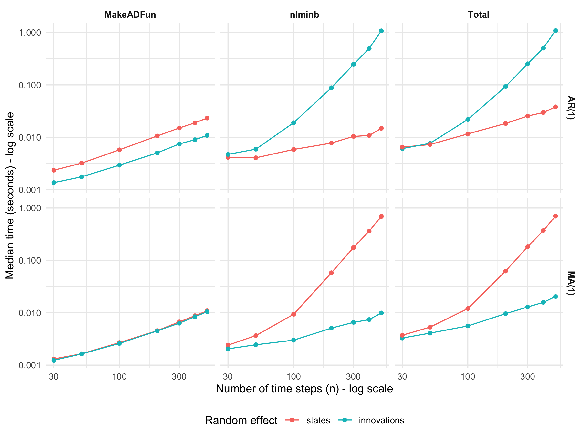
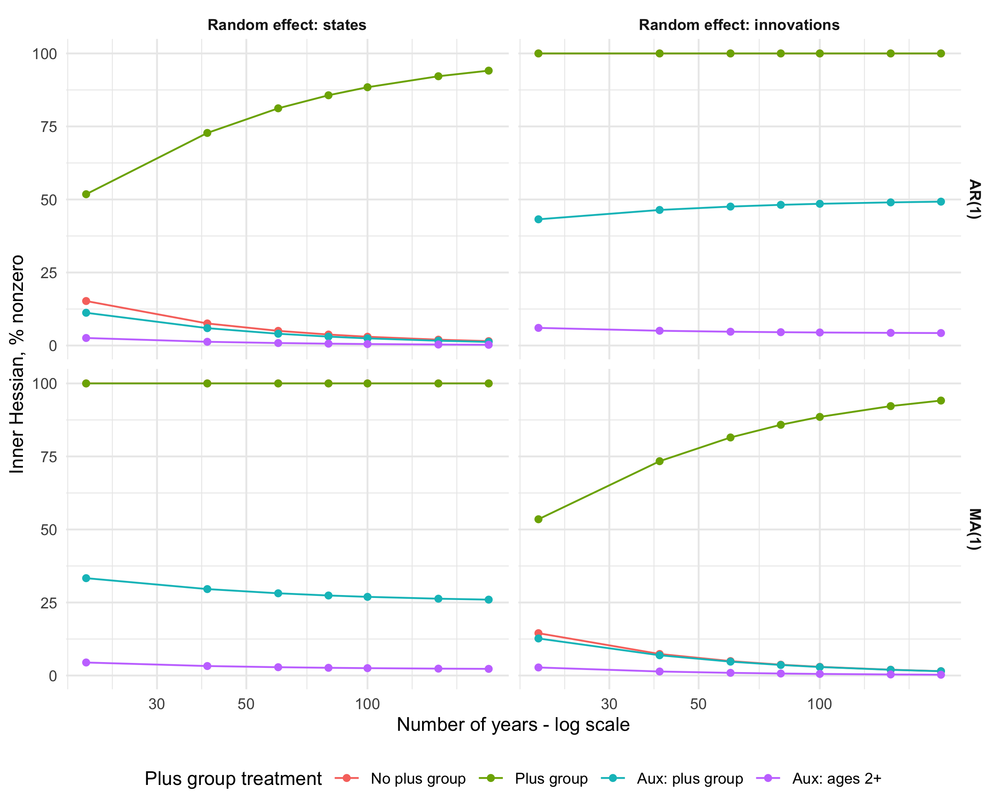
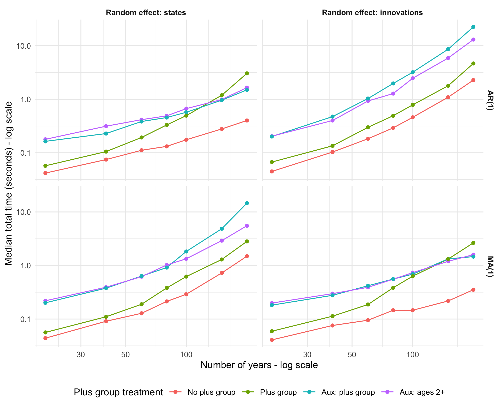

```{r setup, include=FALSE}
knitr::opts_chunk$set(
  echo = FALSE, warning = FALSE, message = FALSE,
  fig.width = 7, fig.height = 5
)
library(ggplot2)
library(dplyr)
library(tidyr)
library(knitr)
library(here)

# generate bib file
source(here("FisheriesResearch_manuscript/BuildBibFile.R"))
build_bib_file()

kable_word <- function(tab, caption, align, widths) {
  out <- knitr::kable(tab, format = "pipe", caption = caption, align = align)
  rule <- paste0(
    ifelse(align == "r", "-", ":"),
    strrep("-", widths - 2),
    ifelse(align == "l", "-", ":")
  )
  out[grep("^\\|[:-]", out)[1]] <- paste0("|", paste(rule, collapse = "|"), "|")
  out
}
```

\
$^{a}$NOAA Fisheries, Office of Science and Technology, Silver Spring,
MD, USA $^{b}$Danish Technical University, Aqua, Kongens Lyngby, Denmark
$^{c}$Vaughan Analytics, in support of NOAA Fisheries Southeast
Fisheries Science Center, Miami, FL, USA $^{d}$NOAA Fisheries, Northwest
Fisheries Science Center, Seattle, WA, USA\
\
$^{*}$**Corresponding author at:** NOAA Fisheries, Office of Science and
Technology, 1315 East-West Highway, 12th Floor, Silver Spring, MD,
20190, USA Email address:
[andrea.havron\@noaa.gov](mailto:andrea.havron@noaa.gov){.email}\
\
ORCID ID: Andrea Havron: 0000-0002-4080-448X Anders Nielsen:
0000-0001-9683-9262 Nathan Vaughan: 0009-0000-3054-6950 Eric Ward:
0000-0002-4359-0296

\newpage

# Abstract {.unnumbered}

Fish populations and fisheries often experience shifts in demographic
and removal processes, which are represented as time-varying within
models that estimate population status and inform harvest advice (i.e.,
stock assessment models). Increasingly, these processes are represented
as random effects using marginal maximum likelihood (i.e., the Laplace
approximation) or Markov chain Monte Carlo (MCMC). However, both
approaches are computationally demanding, and guidance on parameterizing
random effects efficiently is generally lacking. In particular, a
process can be parameterized with either states (e.g., log-recruitment)
or innovations (e.g., recruitment deviations) as the random effect.
While statistically equivalent, these parameterizations differ in how
random effects depend on one another, which can greatly influence
computational time under both approaches. We compared the speed of these
parameterizations for autoregressive [AR(1)] and moving-average [MA(1)]
recruitment processes using: 1) a simple time-series model fitted by
maximum likelihood, and 2) an age-structured model fitted by both
maximum likelihood (up to 200 years) and MCMC. The most efficient
parameterization was process-specific [i.e., states for AR(1) and
innovations for MA(1)], wherein each random effect depended on only a
few others (i.e., a sparse structure). However, within age-structured
models, this advantage was eroded by the plus group, which sums over
every past cohort and creates dependencies among many random effects.
Treating numbers-at-age as random effects (or an auxiliary variable)
removed these dependencies, but only reduced run times for time series
exceeding 100 years. [Eric: MCMC results.] Collectively, our results
offer pragmatic guidance for efficiently parameterizing random effects
in next-generation assessment platforms.

# Keywords {.unnumbered}

random effects; sparsity; Laplace approximation; TMB; Hamiltonian Monte
Carlo; state-space; recruitment; plus group

# Highlights {.unnumbered}

-   Random effect choice determines Hessian sparsity: states for AR(1),
    innovations for MA(1)
-   The plus group makes any recruitment random effect dense, where the
    cost grows with years
-   Numbers-at-age random effects (or auxiliary variables) restore
    sparsity under maximum likelihood, but increase model complexity
-   [Eric: MCMC results]

\newpage

# Introduction

The processes governing fish populations and their associated fisheries
can vary considerably over time. For instance, recruitment (i.e., the
addition of young fish to the population) often fluctuates among years
in response to environmental conditions, while fishery selectivity can
change with shifts in fishing practices and management regulations
[@Thorson_2014b; @Szuwalski_2016]. These temporal changes have important
implications for fisheries management because stock assessment models,
which are used to estimate population status and inform harvest advice,
can be highly sensitive to assumptions about how population and fishery
processes vary over time. Notably, treating time-varying processes as
constant can lead to biased estimates of spawning biomass and management
reference points [@Martell_2014]. Consequently, annual variation in
recruitment is estimated in nearly all contemporary assessments, and
variation in processes like selectivity and natural mortality is
increasingly applied [@Punt_2020].

Historically, these processes have been estimated using a penalized
maximum likelihood framework, where models estimate deviations as fixed
effects that are then constrained by a penalty [@Maunder_2003], owing in
part to limitations of the software commonly used for specifying
non-linear stock assessment models [i.e., AD Model Builder (ADMB);
@Fournier_2011]. Although this approach is computationally efficient,
the variance of these deviations cannot generally be estimated
adequately, and must instead be pre-specified or iteratively tuned by
the analyst [@Thorson_2014c]. In particular, the standard deviation of
recruitment deviations is commonly tuned alongside an explicit bias
adjustment [@Methot_2011], while penalties that constrain time-varying
selectivity (or other demographic processes) [@Martell_2014;
@Nielsen_2014] are often specified on an ad-hoc basis. Thus, penalized
maximum likelihood approaches are not entirely objective, given that
tuned variances are subsequently treated as known (i.e., their
uncertainty is ignored), with some studies demonstrating that assessment
outcomes can be affected by the degree of flexibility specified for such
processes [@Nielsen_2014]. These limitations can generally be overcome
by treating time-varying processes as random effects and integrating
them out using either the Laplace approximation in the maximum
likelihood paradigm, or Markov chain Monte Carlo (MCMC) in the Bayesian
paradigm, thereby allowing variance parameters to be estimated rather
than tuned [@Aeberhard_2018]. For example, @Nielsen_2014 demonstrated
that time-varying selectivity for North Sea cod could be estimated
objectively using Laplace Approximation when fishing mortality at age
was treated as a latent process.

Although both paradigms have long been available within the software
commonly used to develop stock assessment models [@Skaug_2006;
@Fournier_2011], their routine application was often impeded by long run
times, particularly for models with a large number of random effects
[@Kristensen_2016; @Monnahan_2019]. Recent advances in software have
alleviated much of this burden in both paradigms. For instance, earlier
frameworks (e.g., ADMB) required analysts to manually identify which
likelihood contributions were conditionally independent when applying
the Laplace approximation, resulting in a cumbersome and tedious
implementation of random effects [@Skaug_2006]. By contrast, newer
software such as Template Model Builder (TMB) implements the same
approximation, but detects this conditional independence automatically
and is therefore considerably faster [@Kristensen_2016]. Similarly,
gradient-based sampling algorithms (e.g., the no-U-turn sampler) have
reduced run times in the Bayesian paradigm [@Monnahan_2018;
@Monnahan_2019]. Consequently, and with ADMB no longer actively
maintained, next-generation assessment platforms are increasingly
developed in TMB and RTMB [@Nielsen_2014; @Stock_2021; @Cheng_2026;
@Kristensen_2026].

Despite the benefits of newer software platforms, both paradigms can
still remain computationally demanding, and this burden depends not only
on the number of random effects being integrated, but also on how those
random effects depend on one another. In the context of maximum
likelihood estimation, the Laplace approximation requires the repeated
factorization of the random efffects Hessian matrix, and its cost is
therefore governed by the sparsity of this matrix (i.e., the proportion
of its elements that are zero), given that sparse matrices are
considerably faster to factorize than dense matrices. Sparsity is
achieved when each random effect is directly linked to only a few
others, as in spatio-temporal models, wherein the stochastic partial
differential equation approach ensures that each location is
conditionally dependent only on its immediate neighbors, thereby
allowing thousands of random effects to be estimated efficiently
[@Lindgren_2011; @Thorson_2019]. However, sparsity is not guaranteed in
stock assessment models, where modelled quantities are often derived by
summing random effects across years or ages, thereby resulting in
dependence among random effects. For instance, the value of a random
walk in any given year is the sum of all preceding deviations, while
quantities that are aggregated across ages (e.g., total biomass) depend
on every cohort present in the population. In both cases, a single
observation links many random effects, resulting in a dense Hessian
matrix that can be computationally challenging to factorize.

In a similar vein, within the Bayesian paradigm, MCMC requires gradients
to be evaluated repeatedly across thousands of iterations, and its
efficiency is instead governed by the geometry of the posterior
distribution, wherein algorithms tend to sample more efficiently when
random effects are weakly correlated with one another and with their
variance parameters [@Betancourt_2019]. This consideration is well
recognized in the Bayesian literature, where hierarchical models can be
expressed using either a "centered" parameterization, in which latent
states are sampled directly, or a "non-centered" parameterization, in
which standardized innovations are sampled and the states are
subsequently derived [@Papaspiliopoulos_2007]. In Hamiltonian Monte
Carlo, non-centered parameterizations are often adopted in response to
the "funnel" geometry that arises when the variance of the random
effects is small, while centered parameterizations can be more efficient
when the data are highly informative, which can effectively "pin down"
the estimates of the latent states [@Betancourt_2019; @Gorinova_2020].
Thus, in both paradigms, the manner in which random effects are
parameterized can dictate the dependencies among them, and is therefore
no longer a matter of computational convenience, but a design decision
with direct consequences for computational run time.

In the context of stock assessment models, the same choice arises for
any time-varying process (i.e., whether the process itself or its
deviations are treated as random effects), but is typically inherited
from convention rather than deliberately evaluated. Notably, the two
paradigms reward different properties (i.e., a sparse Hessian under
maximum likelihood, and weakly correlated random effects under MCMC),
and the parameterization that reduces computational demand under one is
therefore not necessarily the fastest under the other. Moreover,
sparsity may be less consequential under MCMC, wherein the Hessian is
not typically explicitly utilized during sampling, although recent
algorithms can exploit sparsity to precondition the sampler
[@Monnahan_2026]. Although alternative parameterizations have been
compared for Bayesian surplus production models [@Best_2020], it remains
ambiguous how practitioners should select among them within
age-structured assessment models to ensure efficient estimation, and
where potential pitfalls may arise. To address these uncertainties, we
evaluated the computational performance of mathematically equivalent
parameterizations for first-order autoregressive [AR(1)] and
moving-average [MA(1)] recruitment processes, where either the states or
the innovations were treated as random effects, across two experiments.
These experiments included: 1) a time-series model to illustrate how the
choice of random effect determines Hessian sparsity, and 2)
age-structured models to demonstrate how accumulating cohorts within the
oldest age-class (i.e., a plus group) erodes sparsity, how sparsity
might be recovered, and whether the parameterization that is efficient
under maximum likelihood also samples efficiently under MCMC.
Collectively, results from our study aim to offer pragmatic guidance to
analysts and developers seeking to parameterize random effects in
next-generation assessment platforms.

# Methods

To explore how the parameterization of random effects may impact
computational performance, we conducted two experiments that shared the
same recruitment processes [i.e., AR(1) and MA(1)], but differed in the
complexity of the specified population dynamics (Table
\@ref(tab:table-experiments)). In each experiment, recruitment was
parameterized with either the states or the innovations treated as
random effects (hereafter, the states and innovations
parameterizations). The first experiment employed a simple state-space
time-series model, fitted by maximum likelihood, to isolate the
mechanism through which the choice of random effect governs the sparsity
of the Hessian. The second experiment extended these comparisons to an
age-structured assessment model fitted in both frameworks, and consisted
of two components, which included: 1) a maximum likelihood component,
wherein run times were evaluated across time series of increasing length
to determine how the plus group interacts with this choice and whether
auxiliary numbers-at-age random effects can recover sparsity, and 2) an
MCMC component, wherein the same model was sampled using MCMC to
determine whether the parameterization that is efficient under maximum
likelihood also samples efficiently [MCMC comparison to be completed].
Prior to describing each experiment, we first describe the recruitment
processes and software tools utilized, and then outline the mechanism
that is common to both.

We considered both autoregressive AR(1) and moving-average MA(1)
structures because they represent distinct hypotheses about the memory
of the underlying time-series process, and because they can differ in
the sparsity of the resulting Hessian matrix. Following standard
time-series literature [@Shumway_2025], an MA(1) process has finite
memory in that a shock propagates for exactly one time step, whereas an
AR(1) process has potentially infinite memory, with each shock's
influence persisting. In the context of modelling recruitment
variability in fisheries, the AR(1) structure may be more appropriate
when approximating a driver that persists across multiple years (e.g.,
ocean regimes, density dependence), while an MA(1) model may be better
suited for short-term pulses (e.g., cohort effects). We include both
models here to test whether the sparsity results generalize across
processes with fundamentally different memory structures.

## Software tools

All models in both experiments were coded in RTMB [@Kristensen_2026],
which is an R interface to Template Model Builder (TMB) that utilizes
automatic differentiation and the Laplace approximation to integrate out
random effects [@Kristensen_2016]. For the MCMC component of the second
experiment, the same RTMB models were sampled using the no-U-turn
sampler (NUTS) of @Hoffman_2014 via the tmbstan package
[@Monnahan_2018], and were also re-coded directly in Stan
[@Carpenter_2017] for comparison.

## Random effects, sparsity, and the Laplace approximation

Let $f(\theta, u)$ denote the joint negative log-likelihood of the fixed
effects ($\theta$) and random effects ($u$). The Laplace approximation
to the marginal negative log-likelihood can then be written as:

$$-\log L(\theta) \approx f(\theta, \hat{u}) + \tfrac{1}{2} \log \det H(\theta, \hat{u}),$$

up to a constant, where $\hat{u}$ minimizes $f$ with respect to $u$ for
a given value of $\theta$, and
$H = \partial^2 f / \partial u \partial u'$ is the Hessian matrix of the
joint negative log-likelihood with respect to the random effects
[@Kristensen_2016; @Skaug_2006]. Thus, each evaluation of the marginal
likelihood requires an inner optimization to obtain $\hat{u}$, followed
by a factorization of $H$ to compute its determinant. In TMB, this
factorization is performed using a sparse Cholesky decomposition, which
only operates on elements of $H$ that can be non-zero, and consequently,
the computational cost of the Laplace approximation is primarily
governed by the number of non-zero elements in $H$, rather than the
number of random effects (Figure \@ref(fig:figure-1)a-b). In general,
two random effects ($u_j$ and $u_k$) share a non-zero element in $H$ if
at least one term in $f$ involves both of them. The sparsity of $H$ is
therefore determined by which quantities are treated as random effects,
and how the remaining quantities are derived from them.

To illustrate this concept, consider an AR(1) process observed with
error over four time steps, where $x_t = \phi x_{t-1} + \varepsilon_t$.
If the states ($x_t$) are treated as random effects, the process term
for a given time step only involves $x_{t-1}$ and $x_t$, and the
observation term only involves $x_t$, resulting in each state being
linked only to its immediate neighbors. Conversely, if the innovations
($\varepsilon_t$) are treated as random effects, each state must be
reconstructed from all preceding innovations (e.g.,
$x_3 = \phi^2 \varepsilon_1 + \phi \varepsilon_2 + \varepsilon_3$), and
the observation term at each time step therefore involves every
innovation up to that point. The corresponding sparsity patterns of the
Hessian can then be represented as:

$$H_{\text{states}} = \begin{bmatrix} \times & \times & 0 & 0 \\ \times & \times & \times & 0 \\ 0 & \times & \times & \times \\ 0 & 0 & \times & \times \end{bmatrix}, \quad\quad H_{\text{innovations}} = \begin{bmatrix} \times & \times & \times & \times \\ \times & \times & \times & \times \\ \times & \times & \times & \times \\ \times & \times & \times & \times \end{bmatrix},$$

where $\times$ denotes a non-zero element, and the states and
innovations parameterizations result in a tridiagonal and a dense
Hessian, respectively (Figure \@ref(fig:figure-1)c). Although
differences between the two are trivial for four time steps, the cost of
factorizing a tridiagonal matrix scales linearly with the number of time
steps ($n$), while the cost of factorizing a dense matrix scales with
$n^3$. For example, a 50-year time series results in 148 non-zero
elements out of 2,500 (\~6%) under the states parameterization, compared
to all 2,500 under the innovations parameterization.

By contrast, for an MA(1) process (i.e., $x_t = \varepsilon_t + \theta
\varepsilon_{t-1}$), these roles are reversed (Figure
\@ref(fig:figure-1)d). Here, each state in a MA(1) process only involves
two innovations, and treating the innovations as random effects
therefore results in a banded (sparse) Hessian. However, treating the
states as random effects requires that innovations be recovered
recursively (i.e., $\varepsilon_t = x_t - \theta \varepsilon_{t-1}$),
which introduces all preceding states into each term, thereby resulting
in a dense Hessian. We note that the states and innovations
parameterizations correspond to the centered and non-centered
parameterizations in the Bayesian literature, respectively
[@Papaspiliopoulos_2007]. Collectively, these examples illustrate that
the sparse parameterization is the one in which each likelihood term
remains "local" (i.e., only involves a small number of neighboring
random effects).

```{r figure-1, echo=FALSE, fig.cap="Why the choice of random effect sets the cost of the Laplace approximation. (a) Every outer gradient step factorizes the Hessian H of the joint likelihood with respect to the random effects, and two random effects are joined in H whenever some likelihood term contains both. (b) A sparse Cholesky only visits entries that can be nonzero, so a banded H costs order n and a dense H order n cubed. (c) AR(1): declaring the states random keeps every term local; declaring the innovations random requires rewriting each state as a sum over all earlier innovations. (d) MA(1): the same rewrite with the roles swapped. (e) The plus group holds survivors from every cohort, so its observation terms contain every recruitment random effect back to year one regardless of the recruitment parameterization.", out.width="100%"}

```

In age-structured stock assessment models, the AR(1) and MA(1) processes
described above are typically applied to recruitment, wherein the states
and innovations parameterizations correspond to modelling
log-recruitment and recruitment deviations, respectively. However,
sparsity in these models is not determined by the parameterization of
recruitment alone. Notably, the oldest age-class is commonly specified
as a plus group (i.e., an age-class that represents all individuals of
that age and older), given that older individuals are often difficult to
age reliably and are sparsely represented in the data [@Quinn_1999]. In
each year, numbers in the plus group therefore comprise two components:
individuals that were already in the plus group and survived, and
survivors from the preceding age-class that have newly entered it. Let
$P_t$ denote numbers in the plus group, $C_t$ the cohort entering the
plus group, and $S$ the survival rate. The plus group is then updated as
$P_t = C_t S + P_{t-1}
S$, and recursively substituting this expression yields $P_t = C_t S +
C_{t-1} S^2 + C_{t-2} S^3 + \ldots$ Because each cohort is derived from
its own recruitment random effect, observations of the plus group
involve the recruitment random effects of every cohort that has entered
it, and the Hessian therefore becomes dense, irrespective of how
recruitment is parameterized (Figure \@ref(fig:figure-1)e). For
instance, in a model with a plus group at age 10, an observation of the
plus group in year 40 involves the recruitment random effects of all 31
cohorts that recruited in years 1 – 31. Although the contribution of
each cohort diminishes with time (i.e., by a factor of $S$ in each
year), it never fully disappears, and the corresponding elements of the
Hessian therefore remain non-zero.

We propose that two general approaches can be employed to restore
locality in the presence of a plus group. In the simplest case, the plus
group can be removed, wherein the oldest age represents a true
age-class, and while this is seldom appropriate in practice, it provides
a useful benchmark. Alternatively, auxiliary variables can be introduced
by treating numbers-at-age (either for the plus group only, or for all
ages beyond recruitment) as random effects with an associated process
error. Under this approach, each survival equation becomes a local term
that only links numbers in one age and year to the next, which is
analogous to the state-space structure implemented in SAM and WHAM
[@Nielsen_2014; @Stock_2021]. The standard deviation of this process
error can either be estimated, in which case survival becomes a
stochastic process and the statistical model is altered, or fixed at a
small value, in which case the auxiliary variables serve as a numerical
device that reproduces the deterministic model within the tolerance of a
non-linear optimizer.

```{r table-experiments}
exp_table <- data.frame(
  Experiment = c(
    "Processes",
    "Random effect",
    "Other factors",
    "Estimation",
    "Replication"
  ),
  `1. Time series` = c(
    "AR(1), MA(1)",
    "states, innovations",
    "series length n = 30 to 500",
    "RTMB (Laplace)",
    "100 timings per fit"
  ),
  `2. Age-structured: maximum likelihood component` = c(
    "AR(1), MA(1) recruitment",
    "states, innovations",
    "7 ages; no plus group; plus group; plus group with auxiliary numbers-at-age (plus group only, or ages 2+), process error SD pinned; n = 20 to 200 years. Also plus group, with and without auxiliary numbers-at-age for ages 2+, for replicated data sets of 45 years",
    "RTMB (Laplace)",
    "5 timings per fit of one simulated series; one fit to each of 100 simulated data sets per process at 45 years"
  ),
  `2. Age-structured: MCMC component` = c(
    "AR(1), MA(1) recruitment",
    "states, innovations",
    "[Eric: fill in]",
    "MCMC (tmbstan, Stan) [results to be added]",
    "100 simulated data sets per process"
  ),
  check.names = FALSE
)

kable_word(exp_table,
  caption = "Overview of the two experiments. The two components of Experiment 2 use the same assessment model. In every experiment the random effect for recruitment is either the states (log-recruitment) or the innovations (recruitment deviations).",
  align   = c("l", "l", "l", "l"),
  widths  = c(18, 20, 38, 24)
)
```

## Experiment 1: time-series models

The first experiment was designed to isolate the mechanism described
above (Figure \@ref(fig:figure-1)c-d) using a simple state-space model
fitted by maximum likelihood. Maximum likelihood was the sole focus of
this experiment because Hessian sparsity is a structural property of a
model that is most directly exploited by the Laplace approximation, and
its consequences for run time can therefore be isolated by simply
increasing the number of random effects. By contrast, the efficiency of
MCMC is governed by the geometry of the posterior distribution, which
depends on the informativeness of the data and the magnitude of the
process variance, rather than on model structure alone, and comparisons
among parameterizations are already well established for simple
hierarchical and state-space models in the Bayesian literature
[@Papaspiliopoulos_2007; @Betancourt_2019; @Best_2020]. Thus, MCMC
comparisons were reserved for the age-structured models in the second
experiment, wherein such guidance is lacking to maintain focus in
Experiment 1.

Observations were assumed to arise from $y_t \sim N(x_t, \sigma_{obs})$,
where the latent process ($x_t$) followed either an AR(1) process (i.e.,
$x_t = \phi x_{t-1} + \varepsilon_t$, where
$\varepsilon_t \sim N(0, \sigma)$ and the initial state was drawn from
the stationary distribution) or an MA(1) process (i.e.,
$x_t = \varepsilon_t + \theta \varepsilon_{t-1}$). Correlation
coefficients were constrained between -1 and 1 using a scaled logistic
transformation (e.g., $\phi = 2\,\text{logit}^{-1}(\tilde\phi) - 1$).
Four models were then developed, which included: 1) an AR(1) process
with states treated as random effects, 2) an AR(1) process with
innovations treated as random effects, where
$\varepsilon_1 \sim N(0, \sigma / \sqrt{1 - \phi^2})$ and $x$ was
derived recursively, 3) an MA(1) process with innovations treated as
random effects (i.e., a vector of length $n + 1$), from which $x$ was
derived, and 4) an MA(1) process with states treated as random effects,
where innovations were recovered recursively (i.e.,
$\varepsilon_t = x_t - \theta \varepsilon_{t-1}$) and the initial
innovation ($\varepsilon_0$) was estimated as a fixed effect.

For each process, a single time series of 500 time steps was simulated,
where $\sigma = \sigma_{obs} = 1$ and $\phi = \theta = 0.7$. Each model
was then fitted to the first $n$ observations of the simulated series,
with $n \in \{30, 50, 100, 200, 300, 400, 500\}$, to evaluate how
computational cost scales with the number of random effects. Run times
were recorded using the bench package [@Hester_2025] across 100
iterations following an initial warm-up period. The time required to
construct the automatic differentiation tape (i.e., `MakeADFun`in TMB)
and to optimize the model (i.e., `nlminb`in R) were recorded separately,
considering that these components can scale differently with $n$, and
computational performance was then summarized as the median run time and
memory allocation across iterations.

## Experiment 2: age-structured models

The second experiment extended the comparison between the states and
innovations parameterizations to an age-structured assessment model,
wherein three factors were varied. First, recruitment followed either an
AR(1) or MA(1) process, which represent alternative statistical
assumptions, and models were therefore only fitted to data simulated
under the same process. Second, either the states or the innovations of
recruitment were treated as random effects, which is the comparison of
interest and represents two equivalent ways of specifying the same
statistical model (i.e., only the sparsity of the Hessian differs).
Third, the treatment of survival and the plus group also varied, given
that the plus group can potentially determine whether a sparse
recruitment parameterization remains sparse in the full model. All data
were simulated from the assessment model itself, and we hereafter refer
to the configuration used to simulate data as the operating model, and
to each configuration fitted to those data as an estimation model.
Estimation models were therefore correctly specified unless noted
otherwise, and comparisons focused on run time rather than estimation
performance (e.g., bias).

Throughout experiment 2, these factors were evaluated in two components.
The maximum likelihood component evaluated run times across treatments
of the plus group, for both time series of increasing length and
replicated data sets at the scale of a typical assessment, while the
MCMC component sampled the latter estimation models to evaluate whether
the parameterization that is efficient under maximum likelihood also
samples efficiently.

### Assessment model

The assessment model was structured after the `simplefsa` data set
[Anders: one sentence on the stock and the source of these data], which
consists of seven age-classes and 45 years of data (1963 – 2007). The
model tracks log-numbers-at-age ($\log N_{a,t}$) over age-classes
$a = 1, \ldots, A$ and years $t = 1, \ldots, T$. Fishing mortality is
modelled as a separable age-year product,
$F_{a,t} = \exp(\log F_a + \log F_t)$, with a shared age effect for ages
5 – 7. Cohorts are propagated forward by the following dynamics:

$$\log N_{a,t} = \log N_{a-1,t-1} - F_{a-1,t-1} - M_{a-1,t-1}, \quad 1 < a < A,$$

where $M_{a,t}$ is set at 0.8, 0.35, and 0.25 for ages 1 – 3, and 0.2
thereafter. In its default configuration, the terminal age-class is a
plus group that also retains its own survivors (i.e.,
$N_{A,t} = N_{A-1,t-1} e^{-F_{A-1,t-1} - M_{A-1,t-1}} + N_{A,t-1} e^{-F_{A,t-1} - M_{A,t-1}}$),
and survival is deterministic, where numbers-at-age beyond recruitment
are fully determined by recruitment, numbers-at-age in the first year,
and mortality. Alternative treatments of the plus group and of survival
are described under each component in the following sections.
Observations consist of commercial catch-at-age from a single fishery
fleet and a survey index for ages 1 – 5, both modelled with lognormal
observation error and an estimated standard deviation. Weight-at-age and
maturity-at-age were treated as known inputs, and numbers-at-age in the
first year were estimated as fixed effects. To ensure equivalence
between maximum likelihood and Bayesian implementations, all standard
deviation parameters were given $N(0,1)$ priors on the log scale.

Recruitment (i.e., $\log N_{1,t}$) was modelled using one of two
processes. Under the first-order moving-average [MA(1)] process,
recruitment is derived from annual deviations ($\varepsilon_t$) as:

$$\log N_{1,t} = \mu_R + \varepsilon_t + \theta \varepsilon_{t-1}, \quad \varepsilon_t \sim N(0, \sigma_R),$$

where $\theta = 2\,\text{logit}^{-1}(\tilde\theta_R) - 1$. Under the
first-order autoregressive [AR(1)] process, recruitment is instead
modelled as:

$$\log N_{1,t} = \phi \log N_{1,t-1} + \mu_R(1 - \phi) + \sigma_R \sqrt{1 - \phi^2}\, z_t, \quad z_t \sim N(0,1),$$

where the autoregressive parameter is
$\phi = 2\,\text{logit}^{-1}(\tilde\phi_R) - 1$ and $\sigma_R$ is the
marginal standard deviation of the process. For each process, either the
states (i.e., $\log N_{1,t}$) or the innovations (i.e., $\varepsilon_t$
or $z_t$) were then treated as random effects, as described previously,
with the remaining quantity derived from them. Thus, the two processes
represent different models, whereas the two parameterizations of a given
process represent the same model and are expected to yield identical
estimates.

To ensure that simulated data resembled a typical assessment, parameter
values of the operating model were obtained in both components by
fitting the assessment model to the `simplefsa` data set, and details
that are specific to the data simulated for each component (e.g., the
length of the time series) are described in the following sections.

### Maximum likelihood component

The maximum likelihood component consisted of two analyses, which
evaluated how run times scaled with the length of the time series, and
whether these patterns held across replicated data sets at the scale of
a typical assessment. We first describe the treatments of survival and
the plus group that were considered, followed by each analysis.

*Treatments.* Four treatments were crossed with the states and
innovations parameterizations of recruitment, which included: 1) no plus
group, where the terminal age represented a true age-class and served as
a benchmark, 2) a plus group, as in the default configuration of the
assessment model, 3) a plus group with auxiliary random effects on plus
group numbers only, and 4) a plus group with auxiliary random effects on
numbers-at-age for all ages beyond recruitment (i.e., ages 2+).
Auxiliary random effects were assumed to arise from normal process error
around the deterministic survival prediction, with a standard deviation
fixed at $10^{-4}$. Treatments 3 and 4 are therefore statistically
equivalent to treatment 2 within the tolerance of a non-linear
optimizer, which was confirmed by comparing negative log-likelihood
values at the optimum (i.e., all were within $10^{-3}$ of treatment 2).

*Time series length.* The four treatments were fitted to time series of
increasing length. For each recruitment process, a single 200-year
series was simulated from the operating model with a plus group, along
with a second series without a plus group that was only used for
treatment 1. Given that the `simplefsa` data set only spans 45 years,
the estimated series of annual fishing mortality was repeated to span
200 years, and a survey index was simulated in every year (i.e., the
survey in the `simplefsa` data set is only available for the final 25
years). Models were then fitted to the first $n_t$ years of each series,
where $n_t \in \{20, 40, 60, 80, 100, 150, 200\}$.

Run times were again recorded using the `bench` package, with five
iterations per model following an initial warm-up period. Here, we
recorded the time required for tape construction alone, as well as for
tape construction and optimization combined, with optimization time
computed as the difference between the two. This ensured that each
optimization began from a "cold start", given that re-optimizing an
existing model object initializes the inner optimization at previously
estimated random effects, which artificially favors models that are run
later. For each model, we also recorded the percentage of non-zero
elements in the Hessian of the random effects at the optimum (hereafter,
the inner Hessian), the negative log-likelihood, the maximum absolute
gradient, and whether the Hessian of the fixed effects was positive
definite.

*Replicated data sets.* To evaluate whether these patterns held with
replication at the scale of a typical assessment, treatments 2 and 4
(i.e., a plus group, with and without auxiliary random effects for ages
2+) were also fitted to 100 simulated data sets of 45 years for each
recruitment process. Data sets were simulated from the assessment model
without a plus group, with recruitment and all parameters held at the
values estimated from the `simplefsa` data set, and replicates therefore
only differed in their observation errors. Thus, both treatments assumed
a plus group that was absent from the operating model, and comparisons
were primarily made between parameterizations within a treatment. Each
model was fitted once to each data set from a cold start, with run times
and diagnostics recorded as described above.

### MCMC component

[Eric: fill in]

# Results

## Experiment 1: time series

```{r ts-data}
ts_files <- c("AR(1)" = here("R/simple_benchmark/ar1_benchmark.rds"),
              "MA(1)" = here("R/simple_benchmark/ma1_benchmark.rds"))
ts_tot <- bind_rows(lapply(names(ts_files), function(p) readRDS(ts_files[[p]])$totals |> mutate(process = p)))
# total time (tape construction + optimization); method is "process" (states) or "deviations" (innovations)
ts_time <- function(proc, m, nn = 500) {
  ts_tot |> filter(process == proc, method == m, n == nn) |> pull(total_time)
}
ts_ratio <- function(proc, slow, fast, nn = 500) ts_time(proc, slow, nn) / ts_time(proc, fast, nn)
# the text states that AR(1) run times were comparable for n <= 50 and that the
# MA(1) innovations parameterization was faster at every n
ts_n <- sort(unique(ts_tot$n))
stopifnot(
  all(abs(log(sapply(ts_n[ts_n <= 50], function(k) ts_ratio("AR(1)", "deviations", "process", k)))) < log(1.25)),
  all(sapply(ts_n, function(k) ts_ratio("MA(1)", "process", "deviations", k)) > 1)
)
f1 <- function(x) sprintf("%.1f", x)
f0 <- function(x) sprintf("%.0f", x)
f2 <- function(x) sprintf("%.2f", x)
```

In general, patterns in run time for the time-series models were
consistent with expectations (Figure \@ref(fig:figure-1)), with the
AR(1) and MA(1) processes exhibiting opposing results (Figure
\@ref(fig:figure-2)). For the AR(1) process, run times increased more
rapidly with the length of the time series under the innovations
parameterization, and were approximately
`r f0(ts_ratio("AR(1)", "deviations", "process"))` times longer than
those of the states parameterization at $n = 500$, although run times
were comparable between parameterizations for short time series
($n \le 50$). By contrast, for the MA(1) process, the innovations
parameterization was faster across all values of $n$, and was
approximately `r f0(ts_ratio("MA(1)", "process", "deviations"))` times
faster at $n = 500$. As expected, both parameterizations of a given
process also converged to the same maximum likelihood estimates, with
only the sparsity of the inner Hessian matrix differing.

```{r figure-2, echo=FALSE, fig.cap="Experiment 1. Median time for tape construction (MakeADFun), optimization (nlminb), and in total, against series length, for the AR(1) process (top) and MA(1) process (bottom), with the states or innovations as the random effect. Both axes are log scale.", out.width="100%"}

```

## Experiment 2: age-structured models

### Maximum likelihood component

```{r agestrc-data}
ag_files <- c("AR(1)" = here("R/simple_benchmark/ar1_agestrc_benchmark.rds"),
              "MA(1)" = here("R/simple_benchmark/ma1_agestrc_benchmark.rds"))
trt_labels <- c("none" = "No plus group", "naive" = "Plus group",
                "aux_plus" = "Aux: plus group", "aux_all" = "Aux: ages 2+")
ag_time <- bind_rows(lapply(names(ag_files), function(p) readRDS(ag_files[[p]])$timings |> mutate(process = p))) |>
  filter(treatment != "logspace (LSE0)") |>
  mutate(treatment = factor(trt_labels[as.character(treatment)], levels = trt_labels))
ag_diag <- bind_rows(lapply(names(ag_files), function(p) readRDS(ag_files[[p]])$diagnostics |> mutate(process = p))) |>
  filter(treatment != "logspace (LSE0)") |>
  mutate(treatment = factor(trt_labels[as.character(treatment)], levels = trt_labels))

tot <- function(proc, trt, re, n = 200) {
  ag_time |> filter(process == proc, treatment == trt, rec_re == re, func == "Total", n_t == n) |> pull(median_time)
}
dens <- function(proc, trt, re, n = 200) {
  ag_diag |> filter(process == proc, treatment == trt, rec_re == re, n_t == n) |> pull(pct_dense)
}
# the text states that every benchmark fit had a positive definite Hessian
stopifnot("pd_hess" %in% names(ag_diag), all(ag_diag$pd_hess))
```

Results from Experiment 2 were also consistent with expectations (Figure
\@ref(fig:figure-1)e), wherein the plus group substantially reduced the
sparsity of the inner Hessian (Figure \@ref(fig:figure-3)). In the
absence of a plus group, the sparse parameterization for each process
[i.e., AR(1) states and MA(1) innovations] maintained a banded inner
Hessian, with approximately
`r f1(dens("AR(1)", "No plus group", "state"))`% of elements were
non-zero at 200 years, while the alternative parameterization was fully
dense. However, when a plus group was included, the inner Hessian for
the sparse parameterization became nearly as dense as the alternative
(i.e., `r f0(dens("AR(1)", "Plus group", "state"))`% of elements were
non-zero at 200 years), and the percentage of non-zero elements
increased with the length of the time series. Introducing auxiliary
random effects restored sparsity (i.e., fewer than 2% of elements were
non-zero), but only when combined with the sparse recruitment
parameterization, given that the recruitment component of the inner
Hessian otherwise remained dense.

```{r figure-3, echo=FALSE, fig.cap="Experiment 2, maximum likelihood component. Percentage of nonzero entries in the inner (random effect) Hessian at the optimum against the number of years, for AR(1) (top) and MA(1) (bottom) recruitment, with the states (left) or innovations (right) as the random effect, under four treatments of the plus group. The no-plus-group series was simulated without a plus group; the other three were fit to the same data.", out.width="100%"}

```

Run times generally followed patterns in sparsity (Figure
\@ref(fig:figure-4)). For a 200-year time series without a plus group,
the sparse parameterization was approximately four to six times faster
than the alternative (e.g.,
`r f2(tot("AR(1)", "No plus group", "state"))` s compared to
`r f2(tot("AR(1)", "No plus group", "innovation"))` s for AR(1)
recruitment). Including a plus group eroded this advantage, wherein run
time for the sparse parameterization increased to
`r f2(tot("AR(1)", "Plus group", "state"))` s, which exceeded that of
the dense parameterization without a plus group. Auxiliary random
effects recovered approximately half of this loss at 200 years (i.e.,
`r f2(tot("AR(1)", "Aux: plus group", "state"))` s when only plus group
numbers were treated as random effects, and
`r f2(tot("AR(1)", "Aux: ages 2+", "state"))` s when ages 2+ were), but
were slower than retaining a deterministic plus group for time series of
100 years or fewer. Moreover, combining auxiliary random effects with
the dense recruitment parameterization resulted in the poorest
performance (i.e., `r f0(tot("AR(1)", "Aux: ages 2+", "innovation"))` –
`r f0(tot("AR(1)", "Aux: plus group", "innovation"))` s at 200 years).
Patterns were similar for MA(1) recruitment, albeit with the
parameterizations reversed. Across all models, differences in run time
were small for time series shorter than approximately 50 years (i.e.,
the length of many contemporary assessments), where all models were
fitted in approximately 1 s or less. All models converged to the same
negative log-likelihood when fitted to the same data (i.e., within
$10^{-3}$), and the Hessian was positive definite in all cases.

```{r figure-4, echo=FALSE, fig.cap="Experiment 2, maximum likelihood component. Median total time (tape construction and optimization from a cold start) against the number of years, for AR(1) (top) and MA(1) (bottom) recruitment with the states (left) or innovations (right) as the random effect, under four treatments of the plus group. Both axes are log scale.", out.width="100%"}

```

```{r replicate-data}
rep_files <- c("AR(1)" = here("R/simple_benchmark/agestrc_replicates_ar1.rds"),
               "MA(1)" = here("R/simple_benchmark/agestrc_replicates_ma1.rds"))

rep_fit <- bind_rows(lapply(names(rep_files), function(p) readRDS(rep_files[[p]]) |> mutate(process = p))) |>
  filter(treatment %in% c("naive", "aux_all")) |>
  mutate(treatment = factor(trt_labels[as.character(treatment)], levels = trt_labels[c("naive", "aux_all")]),
         sparse = (process == "AR(1)" & rec_re == "state") | (process == "MA(1)" & rec_re == "innovation"))
rep_sum <- rep_fit |>
  group_by(process, treatment, rec_re, sparse) |>
  summarise(time = median(total_time), pct = median(pct_dense), .groups = "drop")

rtime <- function(proc, trt, re) rep_sum |> filter(process == proc, treatment == trt, rec_re == re) |> pull(time)
rpct <- function(proc, trt, re) rep_sum |> filter(process == proc, treatment == trt, rec_re == re) |> pull(pct)

rep_aux <- rep_sum |>
  group_by(process, rec_re) |>
  mutate(ratio = time / time[treatment == "Plus group"]) |>
  ungroup() |>
  filter(treatment == "Aux: ages 2+")
rep_nll <- rep_fit |>
  group_by(process, i) |>
  mutate(d = abs(nll - nll[treatment == "Plus group" & rec_re == "state"])) |>
  ungroup()
rep_wide <- rep_sum |>
  select(process, treatment, sparse, time) |>
  pivot_wider(names_from = sparse, values_from = time, names_prefix = "sparse_")
stopifnot(
  nrow(rep_fit) == 800, all(rep_fit$pd_hess), max(rep_nll$d) < 1e-3,
  max(rep_sum$time) < 0.5,
  all(with(filter(rep_wide, !(process == "MA(1)" & treatment == "Plus group")), sparse_TRUE < sparse_FALSE)),
  with(filter(rep_wide, process == "MA(1)", treatment == "Plus group"), abs(sparse_TRUE / sparse_FALSE - 1) < 0.05),
  min(rep_aux$ratio) > 2, max(rep_aux$ratio) < 4
)
```

These patterns were consistent when treatments 2 and 4 were fitted to
100 simulated data sets of 45 years, wherein differences among models
were modest and all models were fitted in less than 0.5 s (Table
\@ref(tab:table-mle)). With a plus group alone, the sparse
parameterization was faster for AR(1) recruitment (i.e.,
`r f2(rtime("AR(1)", "Plus group", "state"))` s compared to
`r f2(rtime("AR(1)", "Plus group", "innovation"))` s), while run times
were equivalent between parameterizations for MA(1) recruitment (i.e.,
`r f2(rtime("MA(1)", "Plus group", "innovation"))` s). Auxiliary random
effects again restored sparsity for the sparse parameterization (e.g.,
`r f1(rpct("AR(1)", "Aux: ages 2+", "state"))`% of elements were
non-zero for AR(1) recruitment, compared to
`r f0(rpct("AR(1)", "Plus group", "state"))`% with a plus group alone),
wherein the sparse parameterization was faster for both processes (e.g.,
`r f2(rtime("AR(1)", "Aux: ages 2+", "state"))` s compared to
`r f2(rtime("AR(1)", "Aux: ages 2+", "innovation"))` s for AR(1)
recruitment). However, run times with auxiliary random effects were
approximately two to four times longer than those with a plus group
alone, which is consistent with the results described above for time
series of 100 years or fewer. As before, all models converged to the
same negative log-likelihood for a given data set (i.e., within
$10^{-3}$), and the Hessian was positive definite in all cases.

```{r table-mle}
mle_results <- rep_sum |>
  arrange(process, treatment, desc(rec_re))

mle_table <- data.frame(
  Process = mle_results$process,
  Treatment = mle_results$treatment,
  `Random effect` = ifelse(mle_results$rec_re == "state", "states", "innovations"),
  `Non-zero elements (%)` = f1(mle_results$pct),
  `Total time (s)` = f2(mle_results$time),
  check.names = FALSE
)

kable_word(mle_table,
  caption = "Experiment 2, maximum likelihood component. Median percentage of non-zero elements in the inner Hessian and median total time (tape construction and optimization from a cold start) across 100 simulated data sets of 45 years, for a plus group with and without auxiliary random effects for ages 2+.",
  align   = c("l", "l", "l", "r", "r"),
  widths  = c(11, 19, 19, 29, 22)
)
```

### MCMC component

[Eric: fill in]

# Discussion

Non-stationary dynamics are increasingly recognized as a pervasive
feature of fish populations and their associated fisheries, and the
random effects used to represent these dynamics are now routinely
estimated using marginal maximum likelihood or MCMC, rather than
penalized likelihood. However, there has been limited guidance on how
random effects should be parameterized to ensure that estimation remains
computationally efficient. Across the experiments explored in this
study, the most efficient parameterization was not universal, but
instead followed a simple rule, wherein the quantity that should be
treated as a random effect is the one that keeps each term in the joint
likelihood local (i.e., each term only involves a small number of random
effects). More generally, our results suggest that whether a
time-varying process can be estimated efficiently depends on whether it
modifies numbers-at-age. Processes that do so (e.g., recruitment,
natural mortality, and fishery selectivity) are carried forward through
the survival equations and the plus group, and would therefore be
expected to be dense irrespective of how the process itself is
parameterized, while processes that only enter the observation equations
(e.g., survey catchability) would be expected to remain sparse. Thus,
defaulting to a single parameterization across processes (e.g.,
recruitment deviations) is inadequate, and parameterizations should
instead be evaluated on a process-specific basis, while also considering
how random effects are propagated through the population dynamics.

Herein, we provide several considerations for parameterizing random
effects in next-generation assessment platforms. Firstly, we recommend
that developers select the random effect that keeps each likelihood term
local (i.e., states for autoregressive and random walk processes, and
innovations for moving-average processes), rather than adopting
recruitment deviations by default. Secondly, the sparsity pattern of the
inner Hessian should be inspected for prototype models prior to
evaluating run times (Figure \@ref(fig:figure-1)), as a dense inner
Hessian in a model that is expected to be sparse can be indicative of a
plus group, a summation across ages or years (e.g., spawning biomass
within a stock-recruitment relationship), or a process that modifies
numbers-at-age. Thirdly, the plus group should be recognized as a
pervasive source of density, although its computational cost is likely
to be small for time series shorter than approximately 50 years, and can
be expected to increase thereafter. Lastly, we caution against treating
numbers-at-age as random effects solely to achieve sparsity, considering
that the associated process error can absorb variation arising from
mis-specified processes (e.g., natural mortality, selectivity, or
unreported catch), is often difficult to distinguish from observation
error [@Fisch_2023], and alters the interpretation of a fixed natural
mortality rate [@Miller_2018; @Stock_2021b]. Consequently, we recommend
that process error in numbers-at-age be treated as a modelling decision
that is justified on biological grounds (e.g., to account for unmodelled
movement dynamics) [@Li_2026], with any computational benefits being
viewed as a secondary consideration, particularly as attributing
time-variation to an incorrect process can potentially lead to the
provision of suboptimal management advice [@Szuwalski_2017]. [Eric:
Something on MCMC?]

Our findings contrast with general guidance from the Bayesian
hierarchical modelling literature, which was developed for MCMC sampling
and often favors non-centered parameterizations of random effects (i.e.,
innovations) as a default [@Papaspiliopoulos_2007; @Betancourt_2019;
@Monnahan_2016]. In particular, our maximum likelihood results argue
against a single rule of thumb for centering or not centering random
effects in fisheries assessment models, wherein the most efficient
choice depended on the correlation structure of the underlying process.
For instance, innovations in an MA(1) process only propagate to the
following year and therefore remain sparse, while innovations in an
AR(1) process compound forward through every subsequent year, resulting
in a dense Hessian that a states (i.e., log-recruitment)
parameterization avoids entirely. Considering that AR(1) is a far more
common structure for recruitment autocorrelation in marine stocks
[@Thorson_2014b], directly estimating log-recruitment as the random
effect is likely to yield the largest computational benefits for most
assessments. Similarly, state-space models that treat numbers-at-age as
random effects achieve sparsity as a by-product [@Nielsen_2014;
@Stock_2021], as each survival equation then becomes a local term,
although auxiliary random effects of this kind did not remedy a dense
recruitment parameterization, and only reduced run times for long time
series. [Eric: Some discussion on MCMC results on similarities and
differences?]

Like many simulation studies, several aspects of this study were limited
and could be expanded upon in future studies. First, the models explored
were relatively simple (i.e., seven age-classes, with a single sex and
area), and while the benefits of a sparse parameterization would likely
be greater in models with additional dimensions, memory constraints are
likely to also apply. In particular, the number of numbers-at-age random
effects increases in proportion to the number of age-classes (i.e., one
for each age-class and year), and for longer-lived species, the
time-series length at which these random effects outperform a
deterministic plus group is therefore likely to be longer than reported
here. Additionally, comparisons across time-series lengths were based on
a single simulated time series for each process, and therefore reflect
relative computational cost, rather than estimation performance, while
MCMC was only applied to time series of 45 years. Furthermore, random
effects on other processes (e.g., selectivity, natural mortality, and
weight-at-age), which are often modelled with correlations across ages,
years, and cohorts [e.g., @Xu_2019; @Stock_2021b; @Cheng_2023], were not
evaluated, nor were models that estimate random effects on multiple
processes simultaneously (e.g., recruitment alongside time-varying
selectivity), or higher-order and mixed processes (e.g., ARMA).
Nonetheless, we anticipate that parameterizations that maintain locality
in random effects will preserve sparsity and computational efficiency in
these cases, although this remains to be confirmed.

Over the past several decades, advances in computational tools have
transformed how time-varying processes are represented in stock
assessment models, enabling a transition from penalized likelihood
toward marginal maximum likelihood and fully Bayesian approaches. Yet,
the computational demands of these approaches remain a barrier to their
routine use, particularly when coupled with simulation testing and
management strategy evaluations. Our results demonstrate that a
substantial portion of these costs can be attributed to how random
effects are parameterized, which is often dictated by convention, and
that a simple rule (i.e., treating the quantity that keeps each
likelihood term local as the random effect), coupled with careful
consideration of the plus group, can recover much of the efficiency that
would otherwise be lost. Ultimately, we envision that treating the
parameterization of random effects as an explicit design decision will
help reduce barriers to implementing state-space models, and facilitate
their broader adoption within next-generation assessment platforms.

# References
